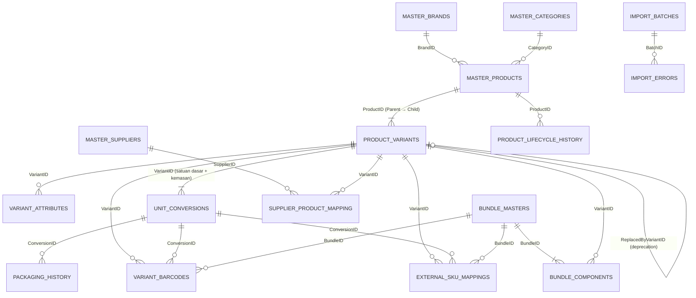

# Revisi v4 — Retail SKU Master Data Management

Dokumen serah terima revisi v4 (termasuk tambahan **GTIN Product Lookup & Smart Auto-Fill**).
Isi: arsitektur, ERD, skema Google Sheets, migrasi, deployment, panduan pengguna, test matrix, keterbatasan, dan rekomendasi.
Revisi sebelumnya: [REVISI-ANALISIS.md](REVISI-ANALISIS.md) (v3), [ANALISIS-TEMPLATE-EXCEL.md](ANALISIS-TEMPLATE-EXCEL.md).

Aturan yang dipegang di seluruh revisi:
- SKU existing tidak pernah diganti otomatis, data historis tidak dihapus, dan migrasi tidak destruktif. Tab dan kolom lama tetap ada; kolom baru ditambahkan di kanan.
- Tidak ada modul harga, approval, transaksi pembelian, atau transaksi inventory.
- GTIN produsen tidak pernah dikarang. Data eksternal hanya menjadi usulan yang harus direview user.
- Tidak ada scraping marketplace dan tidak ada sinkronisasi API marketplace otomatis. Mapping kanal hanya lewat import, ekspor, dan konfirmasi manual.

---

## 1. Arsitektur

```
Browser (Apps Script HtmlService  ATAU  GitHub Pages statis)
   │  google.script.run  /  fetch POST JSON (doPost)
   ▼
Code.gs  api(token, action, params)
   ├─ autentikasi sesi + RBAC (admin · data_entry · viewer)
   ├─ ROUTES: product.* variant.* bundle.* supplier.* supplierMap.* mapping.* gtin.* quality.* import.* export.* …
   └─ rute tulis → withLock_()  (LockService)  + idempotency key (CacheService, disimpan setelah COMMITTED)
        ▼
DatabaseService.gs  Table_ (baca batch, tulis bertahap) → TX_JOURNAL (PENDING → COMMITTED / ROLLED_BACK)
        ▼
Google Sheets (satu spreadsheet = database)          UrlFetchApp → Open Beauty Facts (lookup GTIN, di-cache)
```

| Lapisan | File |
|---|---|
| Konfigurasi & skema | `Config.gs` |
| Infrastruktur data | `DatabaseService.gs` (lock, jurnal, rollback, counter, cache direktori, audit), `Lib.gs` (GTIN, normalisasi nama, konversi) |
| Master | `MasterDataService.gs`, `BrandService.gs`, `CategoryService.gs`, `AttributeService.gs`, `SupplierService.gs` |
| Produk | `ProductService.gs` (Parent), `VariantService.gs` (Child), `UnitConversionService.gs`, `BarcodeService.gs`, `LifecycleService.gs` |
| Operasional | `BundleService.gs` (multipack/mixed/request mix), `MappingService.gs` (kanal, ekspor), `DataQualityService.gs` |
| GTIN lookup | `GtinLookupService.gs` (provider abstraction + cache + rate limit) |
| Data lama | `ImportService.gs`, `MigrationService.gs` |
| Frontend | `Index.html`, `Styles.html`, `Scripts.html` (shell, router, helper), `Pages.html`, `Ops.html` (supplier, bundle, mapping, data quality), `Wizard.html` (registrasi) |

**Hierarki identitas**

```
Brand + Kategori
  └─ Parent SKU  PRD000123   (non-stockable — tidak pernah menjadi item stok)
       └─ Child SKU  SKU000456   (stockable; 1 GTIN produsen atau barcode internal 200…)
            ├─ Kemasan BOX / KARTON (konversi kuantitas; opsional ber-SKU sendiri bila trade item)
            ├─ Kode supplier (banyak supplier per Child SKU)
            ├─ Listing kanal (Shopee/TikTok/Tokopedia/BeeCloud/lainnya; banyak listing per Child SKU)
            └─ Komponen bundle
  Multipack MP000001 / Bundle BDL000001 → BOM dari Child SKU (virtual: tanpa saldo sendiri)
```

## 2. Entity Relationship Diagram



## 3. Skema Google Sheets

Kolom persis seperti `SCHEMA` di `Config.gs`. `setup()` hanya menambah tab/kolom yang belum ada; kolom yang sudah ada tidak diubah.

| Tab | Kolom |
|---|---|
| `Settings` | key, value, updated_by, updated_at |
| `Users` | id, email, full_name, role, is_active, pw_salt, pw_hash, failed_logins, locked_until, last_login_at, created_at, updated_at |
| `SYSTEM_COUNTERS` | CounterName, Value, UpdatedAt |
| `AUDIT_LOGS` | LogID, CreatedAt, Actor, Action, EntityType, EntityID, BeforeJson, AfterJson, MetaJson |
| `TX_JOURNAL` | TxID, Part, Status, CreatedAt, Plan |
| `IMPORT_BATCHES` | BatchID, ImportType, FileName, ContentHash, Status, TotalRows, CreatedRows, SkippedRows, ErrorRows, ReportJson, CreatedBy, CreatedAt |
| `IMPORT_ERRORS` *(baru)* | ErrorID, BatchID, RowNumber, Severity, Message, CreatedAt |
| `GTIN_LOOKUP_CACHE` *(baru)* | GTIN, Provider, Status, FetchedAt, ExpiresAt, ResultJson, Message |
| `MASTER_BRANDS` | BrandID, BrandCode, BrandName, NameKey, Status, CreatedBy, CreatedAt, UpdatedBy, UpdatedAt |
| `MASTER_CATEGORIES` | CategoryID, CategoryCode, CategoryName, NameKey, Status, CreatedBy, CreatedAt, UpdatedBy, UpdatedAt |
| `MASTER_PRODUCTS` | ProductID, ProductNo, BrandID, CategoryID, ProductName, NameKey, ProductCode, BaseUnit, HasVariants, Status, CreatedBy, CreatedAt, UpdatedBy, UpdatedAt, Version, LegacyCode, **Description, ImageUrl, DataSource** |
| `PRODUCT_VARIANTS` | VariantID, ProductID, VariantCode, VariantName, VariantAttributes, AttributeKey, SKU, GTIN, InternalBarcode, IsDefault, Status, SortOrder, CreatedBy, CreatedAt, UpdatedAt, **Stockable, BatchTracking, ExpiryTracking, ShelfLifeMonths, PurchaseUnit, SalesUnit, ReplacedByVariantID** |
| `VARIANT_ATTRIBUTES` | VariantAttributeID, VariantID, ProductID, AttributeName, AttributeValue, SortOrder |
| `ATTRIBUTE_VALUES` *(baru)* | AttributeValueID, AttributeName, Value, ValueKey, Status, CreatedBy, CreatedAt |
| `VARIANT_BARCODES` | BarcodeID, Code, BarcodeType, Symbology, Status, ProductID, VariantID, ConversionID, VerifiedOfficial, RequestKey, Notes, CreatedBy, CreatedAt, RetiredBy, RetiredAt, Reason, **BundleID** |
| `UNIT_CONVERSIONS` | ConversionID, VariantID, ProductID, UnitName, ConversionFactor, ContainsUnit, BaseUnitEquivalent, IsBaseUnit, IsTradeItem, SKU, GTIN, InternalBarcode, Status, SortOrder, CreatedAt, UpdatedAt, **EffectiveFrom** |
| `PACKAGING_HISTORY` *(baru)* | HistoryID, ConversionID, VariantID, ProductID, UnitName, OldFactor, NewFactor, OldContainsUnit, NewContainsUnit, OldEquivalent, NewEquivalent, EffectiveFrom, ChangedBy, Reason |
| `BUNDLE_MASTERS` *(baru)* | BundleID, BundleSKU, BundleType, BundleName, NameKey, StockMode, Stockable, PickQuantity, Status, Description, CreatedBy, CreatedAt, UpdatedBy, UpdatedAt, Version |
| `BUNDLE_COMPONENTS` *(baru)* | ComponentID, BundleID, VariantID, Quantity, Selectable, Status, SortOrder, CreatedAt |
| `MASTER_SUPPLIERS` *(baru)* | SupplierID, SupplierCode, SupplierName, NameKey, ContactName, Phone, Email, Notes, Status, CreatedBy, CreatedAt, UpdatedBy, UpdatedAt |
| `SUPPLIER_PRODUCT_MAPPING` *(baru)* | SupplierMapID, SupplierID, SupplierProductCode, SupplierCodeKey, SupplierProductName, VariantID, ProductID, PurchaseUnit, ConversionFactor, MinimumOrderQuantity, SpecMismatch, SpecNote, Status, CreatedBy, CreatedAt, UpdatedBy, UpdatedAt |
| `EXTERNAL_SKU_MAPPINGS` | MappingID, System, ExternalSku, ProductID, VariantID, ConversionID, InternalSku, ExternalProductId, ExternalVariationId, ListingName, MappingStatus, IsActive, LastExportedAt, LastConfirmedAt, LastError, Notes, CreatedBy, CreatedAt, UpdatedAt, **StoreAccount, ExternalParentSku, BundleID** |
| `PRODUCT_LIFECYCLE_HISTORY` *(baru)* | HistoryID, EntityType, EntityID, ProductID, FromStatus, ToStatus, Reason, ChangedBy, ChangedAt |

**Aturan kunci & keunikan** (diperiksa di server, di dalam lock):

| Data | Aturan |
|---|---|
| Kode otomatis | `PRD`/`SKU`/`MP`/`BDL`/`SUP` + nomor dari `SYSTEM_COUNTERS`; tidak pernah dipakai ulang, termasuk setelah dihapus/diarsipkan |
| Brand / kategori / supplier | `NameKey` (nama dinormalisasi) unik di antara yang belum DELETED; kode 3 huruf unik |
| GTIN / barcode | Satu barcode aktif hanya punya satu pemilik (Child SKU, kemasan, atau bundle); check digit divalidasi |
| Kombinasi varian | `AttributeKey` unik dalam satu Parent |
| Kode supplier | (SupplierID, `SupplierCodeKey`) unik di antara mapping aktif; isi per satuan beli harus sama dengan konversi kemasan Child SKU |
| Listing marketplace | (System, StoreAccount, ExternalProductId, ExternalVariationId) unik di antara mapping aktif |
| BeeCloud | `ExternalSku` unik per sistem; bundle tidak diekspor ke BeeCloud |
| Bundle | Nama & komposisi unik; komponen harus Child SKU aktif |

**Lifecycle**: `DRAFT → ACTIVE/ARCHIVED`, `ACTIVE → INACTIVE/DISCONTINUED`, `INACTIVE → ACTIVE/DISCONTINUED/ARCHIVED`,
`DISCONTINUED → ACTIVE/ARCHIVED`, `ARCHIVED` final. Perubahan ke Nonaktif, Discontinued, Diarsipkan, dan Discontinued → Aktif
wajib diberi alasan (min. 5 karakter). Setiap perubahan dicatat di `PRODUCT_LIFECYCLE_HISTORY`.
Hanya Aktif, Nonaktif, dan Discontinued yang ikut ekspor master. Draft dan Diarsipkan tidak ikut.

## 4. Migrasi

`setup()` menjalankan `migrateLegacy_()` lebih dulu, lalu melengkapi tab, kolom, dan counter. Langkahnya aman diulang:

1. **Tab/kolom baru** ditambahkan; data existing tidak disentuh. Varian lama otomatis dianggap `Stockable = TRUE`. Parent tetap non-stockable.
2. **v1 (template Excel lama)**: baris "Isi > 1" menjadi **Multipack virtual** (`MP…`). SKU lama dipetakan ke `BundleID` lewat `EXTERNAL_SKU_MAPPINGS (legacy)`, sehingga listing Shopee yang memakai SKU paket tetap tertelusur.
3. **v2 → v3** (sudah berjalan sebelumnya): barcode, mapping, counter, dan audit dipindahkan. SKU v2 tidak diganti.
4. **Uji coba sebelum import (dry run)**: menu **Import & Export › Import** menampilkan pratinjau beserta daftar baris yang perlu ditinjau manual. Data baru ditulis setelah tombol import ditekan. Setiap baris yang gagal atau ditolak tercatat di `IMPORT_ERRORS` dan bisa diunduh.
5. Konflik tidak diselesaikan otomatis, hanya dilaporkan. Contohnya kode brand Purbasari `PUR` vs kode lama `PRB`, atau GTIN yang sama dengan kode lama berbeda. Laporannya ada di **Data Quality** dan laporan import.

Hasil uji migrasi dengan workbook asli `Template_Master_Produk_SKU_BeeCloud Fix.xlsx` di emulator:
121 brand, 76 kategori, 114 produk, 442 multipack, 559 SKU lama tertelusur, dan 113 baris ditolak dengan alasan.
Import listing Shopee memetakan 125 listing; 1.289 listing lain tidak punya SKU yang cocok, sehingga dilaporkan dan tidak dipaksakan.
Import ulang bersifat idempoten. Ini hasil emulator, **belum** dijalankan pada spreadsheet produksi.

## 5. Deployment

Kode sudah ada di repo. Urutannya:

1. `clasp push` mengirim kode ke proyek Apps Script, atau push ke `main` lalu workflow `deploy-apps-script.yml` melakukannya.
2. **Wajib, sekali:** di editor Apps Script jalankan fungsi **`setup`**. Langkah ini:
   - membuat tab dan kolom v4 serta counter `multipack_no`, `bundle_no`, dan `supplier_no`;
   - meminta **izin baru "Terhubung ke layanan eksternal" (UrlFetchApp)** untuk lookup GTIN. Klik *Izinkan*. Tanpa izin ini lookup eksternal gagal, sementara registrasi manual tetap berjalan.
3. **Terapkan › Kelola deployment › Edit › Versi baru**, supaya URL Web App tetap sama. Bisa juga dengan `clasp deploy -i <DEPLOYMENT_ID>`.
4. GitHub Pages: **Actions › GitHub Pages › Run workflow**, atau otomatis setelah push. Halaman memakai URL Web App yang sama.
5. Opsional: matikan lookup eksternal di **Settings › GTIN lookup** bila tidak ingin ada panggilan ke Open Beauty Facts.

## 6. Panduan pengguna singkat

| Tugas | Cara |
|---|---|
| Registrasi produk | **Registrasi** › scan GTIN di kolom atas. Bila produk sudah terdaftar, sistem menampilkan produknya dan Anda tidak perlu membuat produk baru. Bila ditemukan di Open Beauty Facts, klik **Pakai usulan** lalu periksa dan edit hasilnya. Bila tidak ditemukan, GTIN langsung terisi dan registrasi dilanjutkan manual. |
| Satu varian vs banyak varian | **Quick Entry** untuk 1 varian. **Advanced** untuk banyak aroma/volume/shade; setiap Child SKU punya GTIN sendiri. |
| Data belum lengkap | **Simpan sebagai Draft**. Draft tidak muncul di ekspor. Aktifkan dari detail produk › **Ubah status**. |
| Satuan beli BOX, jual PCS | Pada bagian **Kemasan, satuan & inventory**, tambahkan BOX isi 24, lalu pilih *Satuan beli* = BOX. Stok selalu dihitung dalam satuan dasar. |
| Batch / kedaluwarsa | Centang *Lacak batch* / *Lacak kedaluwarsa* dan isi masa simpan. Ini hanya konfigurasi: batch berbeda **tidak** membuat SKU baru. |
| Kode supplier | **Supplier SKU Mapping › Petakan kode supplier**. Satu Child SKU boleh dipetakan ke banyak supplier. Kode supplier juga bisa dicari lewat Scan Barcode. |
| Listing marketplace | **Channel SKU Mapping**: pilih kanal, toko, ID produk, ID variasi, SKU induk, dan seller SKU. Status bergerak Belum dipetakan → Dipetakan → Diekspor → Terkonfirmasi, atau Error. Untuk import massal, gunakan **Import & Export › Import › Listing marketplace** dengan file ekspor Shopee. |
| Paket / bundle | **Packaging & Bundle**. *Multipack* = 1 SKU × N. *Mixed* = beberapa SKU. *Request mix* = customer memilih N dari beberapa opsi; komposisi aktualnya disimulasikan saat pemenuhan pesanan. Bundle virtual tidak punya saldo stok. |
| SKU ganda / pengganti | Detail produk › Child SKU › **Deprecate…**. Pilih SKU pengganti; mapping supplier, kanal, dan bundle bisa ikut dipindah. Data lama tetap ada sebagai Discontinued. |
| Cek kualitas data | **Data Quality** menampilkan duplikat, konflik, dan ketidaklengkapan beserta rekomendasi. Sistem tidak pernah melakukan merge otomatis. |
| Ekspor | **Import & Export › Ekspor**: inventory master (hanya Child SKU stockable), master, konversi, BOM bundle, supplier, BeeCloud, mapping. |

## 7. Test matrix (24 skenario)

Status berdasarkan pengujian yang **benar-benar dijalankan** pada 17 Okt 2026:
- **Otomatis**: `npm test`, 32 tes lulus. Tes menjalankan file `.gs` asli di emulator Node (`test/harness.cjs`) dengan tiruan SpreadsheetApp, Lock, Cache, dan UrlFetchApp.
- **Browser**: server pratinjau lokal `dev/server.cjs`, desktop 1366 px dan mobile 375 px.

Belum ada pengujian di Google Apps Script/Sheets produksi untuk v4. Status di sana **Not Tested** sampai `setup` dijalankan dan aplikasi dicoba langsung.

| # | Skenario | Emulator / pratinjau | Bukti | Produksi |
|---|---|---|---|---|
| 1 | Registrasi satu produk sederhana | **Pass** | v4: Quick Entry dari auto-fill; browser: scan → Pakai usulan → Simpan Draft | Not Tested |
| 2 | Parent dengan empat Child SKU | **Pass** | v4: "Parent 4 Child SKU + satuan beli BOX" | Not Tested |
| 3 | GTIN berbeda per varian | **Pass** | v4 #2; scenarios "Advanced 2 aroma × 2 volume" | Not Tested |
| 4 | Kode Parent & Child otomatis | **Pass** | `PRD…`/`SKU…` diperiksa di beberapa tes | Not Tested |
| 5 | Barcode-first registration | **Pass** | v4 "GTIN lookup"; browser: internal / eksternal / tidak ditemukan / tidak valid, Quick & Advanced | Not Tested |
| 6 | Duplikasi barcode | **Pass** | scenarios "kombinasi ganda & GTIN konflik ditolak"; v4 lookup internal | Not Tested |
| 7 | Collision kode brand/kategori | **Pass** | scenarios "Master Brand & Kategori" (Vivelle ≠ VIV, nama ternormalisasi ditolak) | Not Tested |
| 8 | Child SKU dari dua supplier | **Pass** | v4 "satu Child SKU dari dua supplier" | Not Tested |
| 9 | Child SKU di beberapa listing | **Pass** | v4 "beberapa listing & kanal" | Not Tested |
| 10 | Purchase Unit BOX → PCS | **Pass** | v4: 5 BOX = 120 BOTOL; supplier dengan isi berbeda ditolak | Not Tested |
| 11 | Paket virtual 6 PCS tanpa double counting | **Pass** | v4: MP tidak ada di inventory master; Child SKU muncul sekali | Not Tested |
| 12 | Mixed bundle 3 Child SKU | **Pass** | v4 bundle test; browser: editor bundle | Not Tested |
| 13 | Request mix dengan komposisi aktual | **Pass** | v4 `bundle.resolve` (pilihan valid/tidak valid) | Not Tested |
| 14 | Batch berbeda tidak membuat SKU baru | **Pass** (desain) | Batch hanya konfigurasi di Child SKU; tidak ada entitas batch yang bisa membuat SKU. Lot aktual di luar cakupan (inventory) | Not Tested |
| 15 | Parent bukan stock item | **Pass** | v4: `stockable=false` pada Parent, tidak ada di inventory master | Not Tested |
| 16 | Discontinued tidak menghapus histori | **Pass** | v4 lifecycle test + riwayat lifecycle | Not Tested |
| 17 | Rename brand tidak mengubah Child SKU | **Pass** | v4 #16-17; scenarios rename brand | Not Tested |
| 18 | Import legacy SKU dari Excel | **Pass** | `import-excel.test.cjs` dengan workbook asli (angka di §4) | Not Tested |
| 19 | Dua user bersamaan | **Pass (simulasi)** | Lock sibuk & versi basi disimulasikan; emulator tidak bisa menjalankan eksekusi paralel sungguhan | Not Tested |
| 20 | Kegagalan sebagian saat menulis | **Pass** | Injeksi kegagalan tulis → rollback; transaksi PENDING dipulihkan | Not Tested |
| 21 | Ekspor untuk BeeCloud | **Pass dengan catatan** | File ekspor terbentuk, tetapi kolom belum dicocokkan dengan template import resmi BeeCloud | Not Tested |
| 22 | Mapping Shopee (listing & variation ID) | **Pass** | v4: pasangan ID ganda ditolak; import ekspor Shopee asli memetakan 125 listing | Not Tested |
| 23 | Konsisten setelah edit & refresh | **Pass** | v4 "data konsisten setelah edit & muat ulang"; browser: reload lalu data tetap | Not Tested |
| 24 | Semua halaman, navigasi, tombol berfungsi | **Pass (pratinjau)** | Browser: 15 halaman dibuka tanpa error JS, desktop & 375 px tanpa scroll horizontal; formulir supplier, bundle, mapping, lifecycle, dan registrasi dicoba. Tidak semua kombinasi tombol diuji satu per satu | Not Tested |

Bug yang ditemukan dan diperbaiki saat pengujian browser:
- Tiga helper `$()` dipakai sebagai daftar, sehingga navigasi dan pengaturan inventory gagal. Kini dijaga oleh tes statis `frontend-static.test.cjs`.
- Stepper dan tab kanal melebar di layar 375 px.
- Tabel dashboard keluar layar di mobile.
- Hasil scan menampilkan "Nonaktif" untuk produk Draft.

## 8. Keterbatasan yang diketahui

- **Belum diuji di produksi** (lihat §7). `setup` harus dijalankan dan izin UrlFetchApp diberikan.
- **Open Beauty Facts**: cakupan produk Indonesia tipis, dan brand sering kosong. Contoh nyata: 8993137699549 tidak punya brand, sehingga brand ditebak dari kata awal nama dan wajib dicek user. Lisensi ODbL, dengan sumber dicatat di `DataSource`.
- **UrlFetchApp** tidak punya parameter timeout. Strategi yang dipakai: satu panggilan per lookup, cache (FOUND 30 hari, NOT_FOUND 7 hari, ERROR 1 jam), rate limit 20 per menit, dan fallback manual. Apps Script juga bisa menambahkan penanda sendiri pada User-Agent.
- **BeeCloud**: kolom ekspor dan batas panjang SKU belum diverifikasi dengan dokumentasi resmi BeeCloud.
- **Konkurensi** diuji dengan simulasi lock. Uji dua user sungguhan perlu dilakukan di produksi.
- Batas Apps Script: eksekusi 6 menit; import dibatasi 5.000 baris per file; Google Sheets lambat di atas puluhan ribu baris.
- Konflik kode lama (contoh: Purbasari `PUR` vs `PRB`) hanya dilaporkan dan tidak diubah otomatis.
- Pratinjau tampilan mobile diuji di emulasi 375 px, belum di perangkat fisik.

## 9. Rekomendasi berikutnya

1. Jalankan `setup` dan uji 24 skenario di atas langsung di produksi dengan 2 akun, lalu isi kolom "Produksi".
2. Cocokkan `BEECLOUD_EXPORT_COLUMNS` dengan template import BeeCloud yang asli.
3. Tambahkan provider lookup kedua (Verified by GS1 atau API komersial berlisensi) lewat `GTIN_PROVIDER_IMPL`; antarmuka provider sudah tersedia.
4. Lakukan import penuh data lama di salinan spreadsheet terlebih dahulu, tinjau laporan `IMPORT_ERRORS`, lalu jalankan di produksi.
5. Bila jumlah SKU melewati ±20.000 baris, pertimbangkan pindah database (Cloud SQL/Firestore). Lapisan `Table_` memudahkan penggantian.
6. Integrasi inventory/FMS (lot, saldo, transaksi) membaca ekspor inventory master: hanya Child SKU stockable plus konfigurasi batch/expiry.
